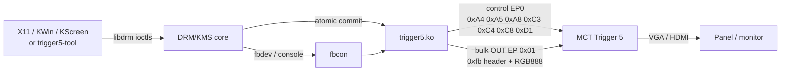
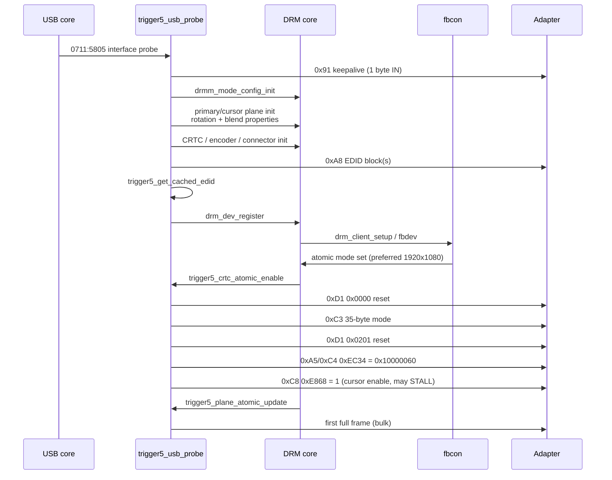
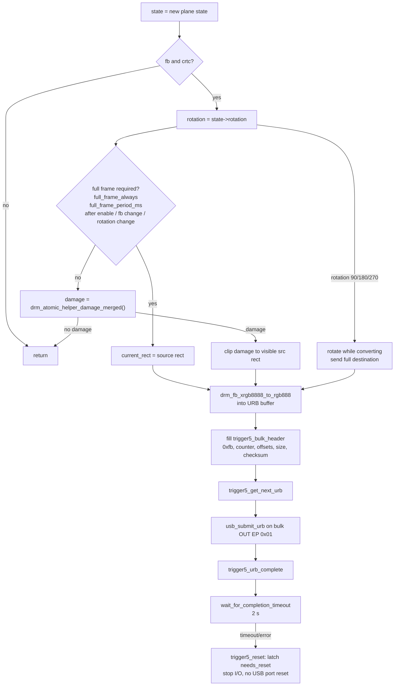
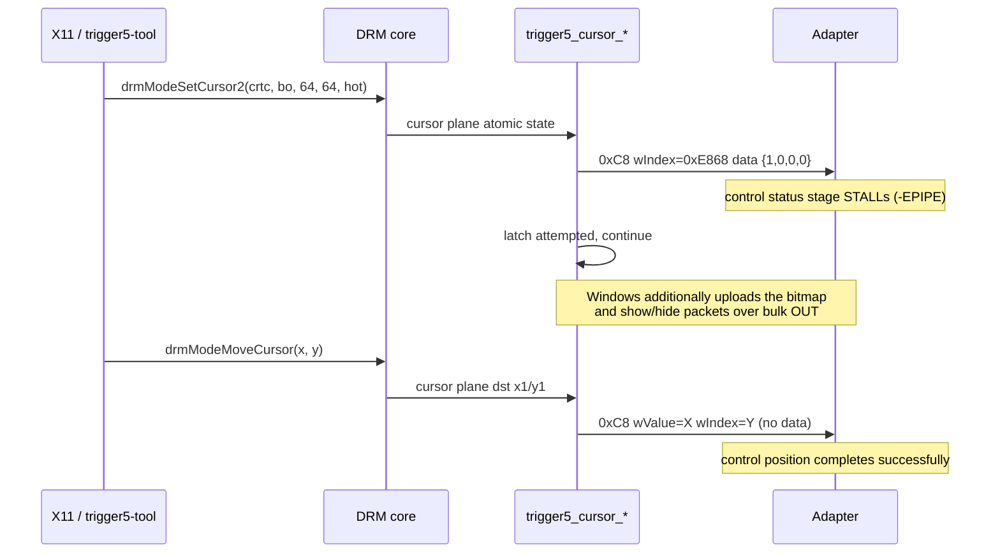

# Trigger 5 Linux driver — call and data flow

This document follows one frame from an X11 client (or `trigger5-tool`) to the
panel, and maps the major call paths through the DRM/KMS core and
`linux-trigger5/trigger5.c`.

## 1. High-level path



There are three distinct channels:

| Channel | Owner | Used for |
|---|---|---|
| Atomic KMS | X11 modesetting, KWin, fbcon, `trigger5-tool` | mode set, plane formats, rotation, damage |
| Legacy cursor ioctls | X11, `trigger5-tool` | `drmModeSetCursor2` / `drmModeMoveCursor` |
| USB control + bulk | `trigger5.ko` only | firmware reset, mode programming, registers, cursor, pixels |

Userspace never speaks the vendor protocol. In particular `trigger5-tool
probe` is read-only and does not issue `0xA1`/`0xA4`/`0xA7`/`0xC8`.

## 2. Probe and initial console mode



Key functions:

- `trigger5_usb_probe()` — allocates the DRM device, finds the bulk-OUT
  endpoint, reads the EDID **before any bulk transfer starts**, creates the
  planes/CRTC/connector/encoder, registers the DRM device and starts fbdev.
- `trigger5_get_cached_edid()` / `trigger5_read_edid()` — the adapter corrupts
  EDID replies while streaming, so the EDID is read once at probe and cached.
- `trigger5_detect()` — `0xA6` status request; returns unknown on failure, but
  the cached EDID still supplies modes.
- `trigger5_connector_get_modes()` — reuses the cached EDID; never re-reads it.

## 3. Mode set / display enable

Userspace calls `drmModeAtomicCommit` (X11, KWin, `trigger5-tool`), or the
legacy `drmModeSetCrtc` path is translated by DRM into an atomic commit.

```
drmModeAtomicCommit
  -> drm_atomic_commit
     -> drm_atomic_helper_check
        -> trigger5_plane_atomic_check
     -> drm_atomic_helper_commit
        -> drm_atomic_helper_commit_tail_rpm
           -> trigger5_crtc_atomic_disable   (only when changing/disabling)
           -> trigger5_crtc_atomic_enable
           -> trigger5_plane_atomic_update
```

`trigger5_crtc_atomic_disable()`:

- hides the cursor with a bulk type-2 hide packet
- stops the bulk stream (`trigger5_stop_io`)
- clears `display_on`, `cursor_enabled` and the cached cursor bitmap

It deliberately does **not** send `0xD1 wValue=0x0001`. That request does not
exist in the Windows driver; the adapter returns `-121`/`-110` and then stops
responding to the following mode set. The next enable sequence programs the
new mode from scratch.

`trigger5_crtc_atomic_enable()`:

1. `drm_dev_enter()`
2. `trigger5_stop_io()` — kill outstanding bulk URBs
3. `0xD1 wValue=0x0000` firmware reset
4. `0xC3` with the 35-byte `trigger5_mode_request`
5. `0xD1 wValue=0x0201`
6. `0xA5` read register `0xEC34`
7. `0xC4` write register `0xEC34 = 0x10000060`
8. `0xC8 wIndex=0xE868` cursor enable (expected to STALL; see §6)
9. clear `needs_reset`, set `full_frame = true`, `display_on = true`
10. re-apply the cursor position if the cursor plane was part of this commit

The mode payload is built from `struct drm_display_mode`:
`height`, `width`, line/frame totals and sync/back-porch values, four `0x00ff`
unknown words, `width-1`, `height-1`, the PLL (`trigger5_calculate_pll`) and
the h/v sync polarity bytes. `docs/usb-protocol.md` documents every field.

## 4. Plane update and pixel path

`trigger5_plane_atomic_check()`:

- calls `drm_atomic_helper_check_plane_state()` with `DRM_PLANE_NO_SCALING`
- reserves the temporary RGB888 conversion buffer
- accepts only `DRM_FORMAT_XRGB8888` on the primary plane

`trigger5_plane_atomic_update()` is the hot path:



Details:

- The primary plane only advertises `DRM_FORMAT_XRGB8888`.
- `DRM_GEM_SHADOW_PLANE_HELPER_FUNCS` copies the GEM framebuffer into a shadow
  buffer so the driver can read it safely.
- `trigger5_submit_urb()` sets `urb->transfer_buffer_length` and submits.
  There are eight 128 KiB URBs; `TRIGGER5_MAX_FRAME_SIZE` is 8 MiB.
- `trigger5_get_next_urb()` waits for the previous URB completion, rotating
  through the eight transfers. A timeout latches `needs_reset`.
- `trigger5_reset()` only logs and latches. `usb_queue_reset_device()` was
  deliberately removed: a port reset has taken down the whole xHCI controller.
- Damage clips come from `drmModeDirtyFB`/`FB_DAMAGE_CLIPS`; the driver rounds
  them the same way `drm_atomic_helper_damage_iter_init()` does.
- Rotation 90/180/270 always sends a full destination frame (partial updates
  under rotation are not implemented).

## 5. Rotation paths

| Caller | Behaviour |
|---|---|
| KWin/Wayland or a compositor that sets the plane `rotation` property | Driver converts pixels and sends full frames. |
| Xorg 1.21 modesetting | Ignores the plane rotation property and rotates in software. The plane stays at rotate-0; X's cursor/damage updates may not reach the driver correctly. |
| X11 workaround | `full_frame_period_ms` forces a complete frame at most every N ms; `full_frame_always` forces one on every commit. Both are runtime module parameters. |

## 6. Cursor path



Functions:

- `trigger5_cursor_atomic_check()` — cursor FB must be ≤ 64×64; uses
  `drm_atomic_helper_check_plane_state(..., can_position=true, ...)`.
- `trigger5_cursor_atomic_update()` — disables on no FB/CRTC; ignores updates
  while `!display_on`; otherwise calls `trigger5_cursor_apply()`.
- `trigger5_cursor_apply()` — attempts enable once if not already latched, then
  always sends the position. Negative coordinates use `value - 1`, matching the
  Windows driver.
- `trigger5_cursor_set_enabled()` — latches `cursor_enabled = enable` even when
  the request returns `-EPIPE`.
- `trigger5_cursor_control()` — single `0xC8` vendor request helper.

**The `0xC8` path is not sufficient.** The Windows capture shows that the
visible cursor is uploaded through bulk packets with counter type 2:

- command 0: upload a 64×64 ARGB bitmap (16 KiB payload);
- command 3: show/move to a position;
- command 5: hide.

The extracted bitmap is a simple arrow. The Linux driver now uploads the
64×64 bitmap and sends commands 0/3/5 as well; hardware verification is
verified at 1920×1080. See
[`../windows-RE-trigger/CURSOR-BULK-PACKETS.md`](../windows-RE-trigger/CURSOR-BULK-PACKETS.md)
for the packet format and the extracted image.

## 7. `trigger5-tool` path

`probe`:

```
main
  -> cmd_probe()
     -> probe_usb()          libusb descriptors, strings, config/interface/endpoint
     -> probe_module()       /sys/module/trigger5/parameters
     -> probe_drm()          /dev/dri/card*, driver name "trigger5"
        -> probe_drm_card()  connector/modes/EDID, CRTCs, planes, properties
     -> probe_drm_sysfs()    /sys/class/drm/*/status, enabled, dpms
```

`test`:

```
main
  -> display_open()             find trigger5 card, connector, CRTC, planes
  -> display_parse_mode()       preferred mode, WxH, or WxH@refresh
  -> dumb_fb_create()           dumb GEM buffer + AddFB2
  -> canvas_init() / pattern_render() / canvas_present()
  -> display_set_mode()         atomic commit:
                                  CRTC MODE_ID + ACTIVE
                                  connector CRTC_ID
                                  plane FB_ID + CRTC_ID + SRC_* + CRTC_*
                                  plane rotation
  -> loop:
       canvas_restore() / pattern_frame_counter() / pattern_block()
       canvas_present()
       display_dirty()          drmModeDirtyFB with damage clips
       display_cursor_move()    drmModeMoveCursor
  -> display_restore()          atomic commit restoring saved FB/mode/rotation
```

`display_restore()` now uses the same atomic helper as `display_set_mode()`
(`atomic_modeset`) so the saved framebuffer, source offsets, mode and rotation
are restored together. This replaced the legacy `drmModeSetCrtc` restore that
failed with `ENOSPC` after a rotated test.

## 8. Frame-timing and failure characteristics

- One bulk URB is 128 KiB. A 1920×1080 RGB888 frame is ~6.2 MiB, so a full
  frame takes ~48–50 URBs; damage updates are much smaller.
- `trigger5_get_next_urb()` has a 2 s completion timeout
  (`TRIGGER5_BULK_TIMEOUT_MS`). A timeout latches `needs_reset` and stops
  further I/O.
- `full_frame_period_ms` (default 0) and `full_frame_always` (default 0) are
  writable at runtime under `/sys/module/trigger5/parameters/`.
- Recovery after a USB error is intentionally manual: replug the dongle or
  unbind/rebind the driver. Do not reintroduce an automatic USB port reset.
- The Windows driver has a vendor reset recovery (`reset0`, 100 ms sleep,
  `reset201`) for `STATUS_IO_TIMEOUT`; that sequence does not reset the USB
  port and could be a safer future recovery mechanism for Linux.

## 9. Known current limitations

- 1920×1080 is the only validated mode. 1024×768 mode-set packets succeed,
  but the panel stays blank: Windows sends compressed frames (`flags=0x71`)
  there, while Linux sends raw RGB888 (`flags=0x01`). The 0xA4 table/index
  semantics are not fully decoded.
- The cursor bulk type-2 bitmap/show/hide path is implemented and verified at
  1920×1080. The Windows bitmap and show/hide sequence are documented in
  `windows-RE-trigger/CURSOR-BULK-PACKETS.md`.
- The tool's portrait modes currently pre-rotate the canvas into the
  framebuffer, so the driver's plane rotation cancels the tool's rotation.
  Portrait output should be drawn in framebuffer orientation.
